

# Motel Bela Vista

**Landing page institucional do Motel Bela Vista, em São Leopoldo - RS.**

 

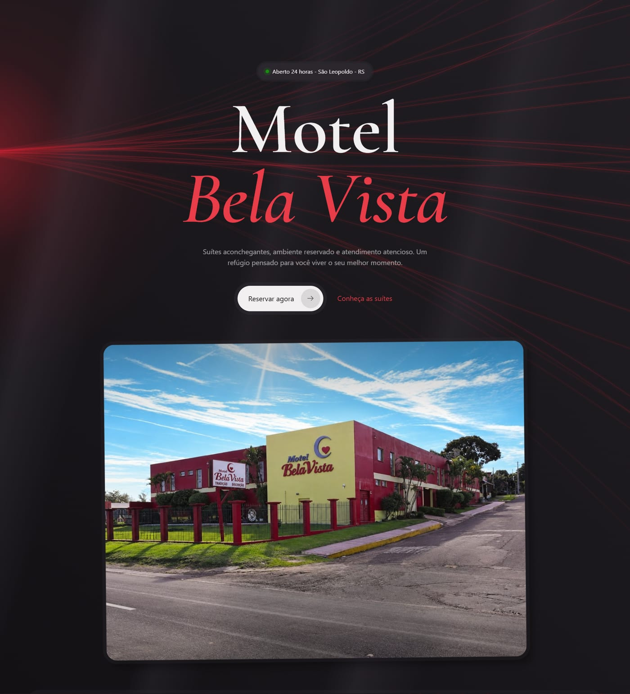

 

## Sobre o projeto

Site de página única que apresenta o motel, mostra as categorias de suítes com fotos reais e facilita o contato e a reserva pelo WhatsApp. Tudo foi feito sem framework de CSS, com animações próprias e suporte a **tema claro e escuro**, que acompanha o aparelho do visitante e pode ser trocado no botão do cabeçalho.

- Layout responsivo, com versão própria para celular
- Animações de entrada, texto que acende ao rolar, cards com inclinação 3D e botões magnéticos
- Carrossel de fotos em cada suíte
- Botões de reserva e consulta que abrem o WhatsApp com a mensagem já preenchida
- Todo o conteúdo (telefones, suítes, comodidades, textos) editável em arquivos simples, sem mexer nos componentes

## Tour pelas seções

Cada seção da página, na ordem em que aparece.

### 1. Cabeçalho e menu

Cabeçalho fixo com a logo à esquerda, o botão de **tema claro/escuro** e o botão **Menu**. O menu abre um painel com os links numerados das seções, o atalho **Reservar pelo WhatsApp** e os ícones das redes sociais (Instagram, WhatsApp e Facebook). Fecha com `Esc` ou ao clicar fora.

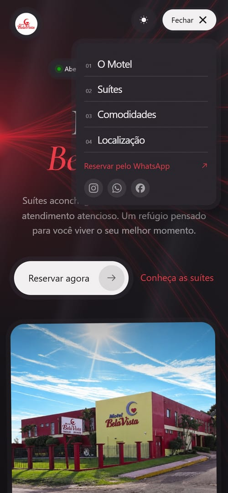

### 2. Hero

A primeira impressão: título em fonte serifada com animação letra a letra, feixes de luz vermelhos ao fundo, a etiqueta **Aberto 24 horas - São Leopoldo - RS**, o botão **Reservar agora** e a foto da fachada, que inclina levemente ao passar o mouse.

### 3. Faixa de diferenciais

Uma faixa que corre continuamente logo abaixo do hero, com os pontos fortes do motel: *Privacidade total, Discrição, Conforto, Atendimento 24h, Higiene impecável, Ambientes românticos* e *Estacionamento privativo*.

### 4. O Motel

Texto de apresentação cujas palavras **acendem conforme a rolagem**, foto da área interna e das garagens com a logo sobreposta, e três números que contam de zero até o valor final: **24h** de atendimento, **100%** de discrição e **365** dias por ano.

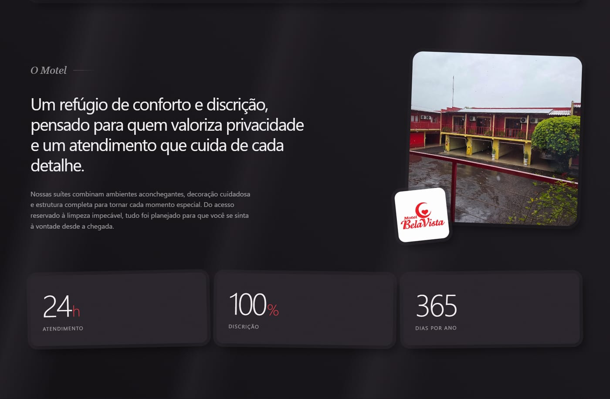

### 5. Suítes

Cinco categorias, cada uma em um card com **carrossel de fotos reais** (setas, indicadores e rolagem por toque): **Standard, Luxo, Super Luxo, Mini-Suíte** e **Suíte**. O botão **Consultar** abre o WhatsApp já perguntando sobre aquela suíte.

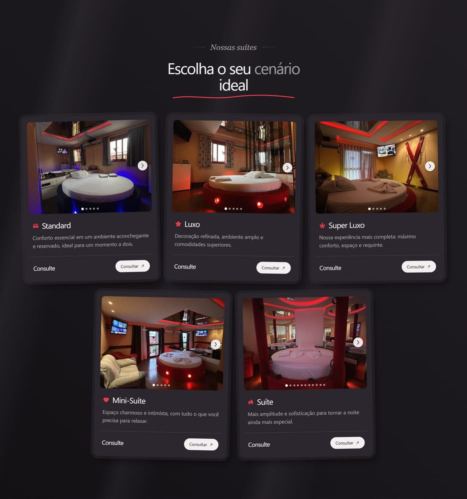

### 6. Comodidades

Seis diferenciais com ícone: privacidade e sigilo, garagem privativa, climatização, entretenimento, room service e atendimento 24 horas.

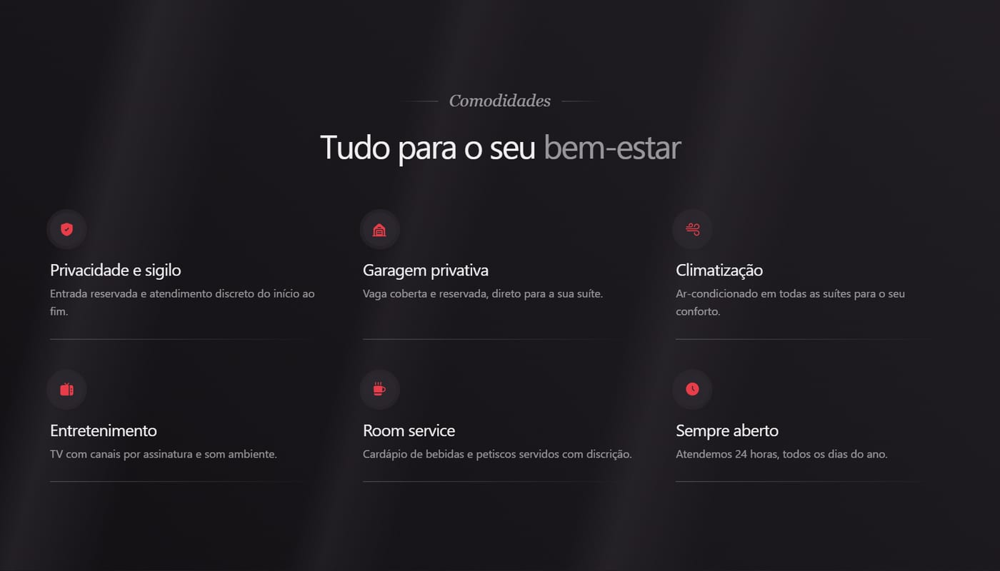

### 7. Chamada para reserva

Bloco de destaque em vermelho, com o convite **"Pronto para uma noite especial?"** e o botão **Chamar no WhatsApp**, que abre a conversa com a mensagem de reserva pronta.

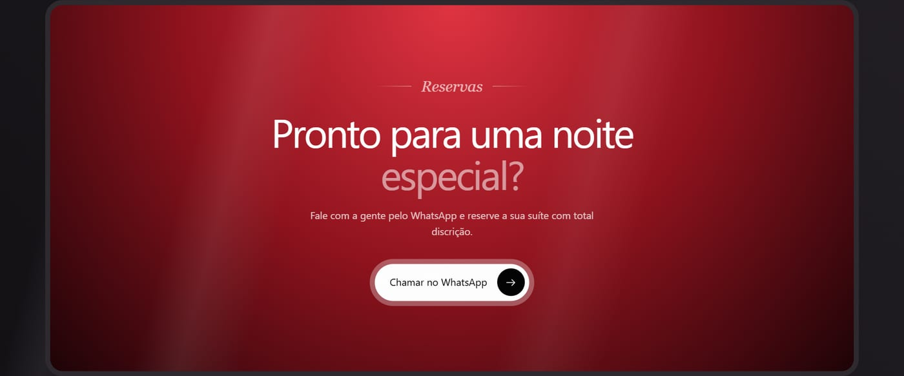

### 8. Localização

Cartão com endereço, telefones (clicáveis para ligar) e horário de funcionamento, o botão **Como chegar** e o **mapa do Google** incorporado, já com o pino do motel.

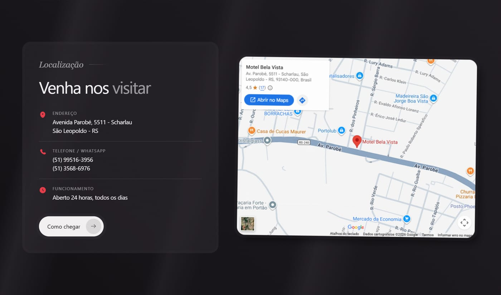

### 9. Rodapé

Logo, frase de boas-vindas, redes sociais, links de navegação, contatos e o aviso **+18**.

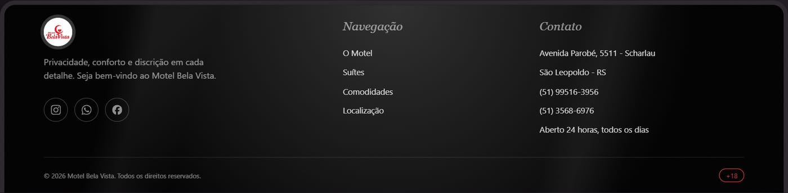

## Tema claro e escuro

O site respeita o tema do aparelho e guarda a escolha do visitante. Os mesmos componentes ganham duas versões completas:

| Tema escuro | Tema claro |
| :---: | :---: |
|  | 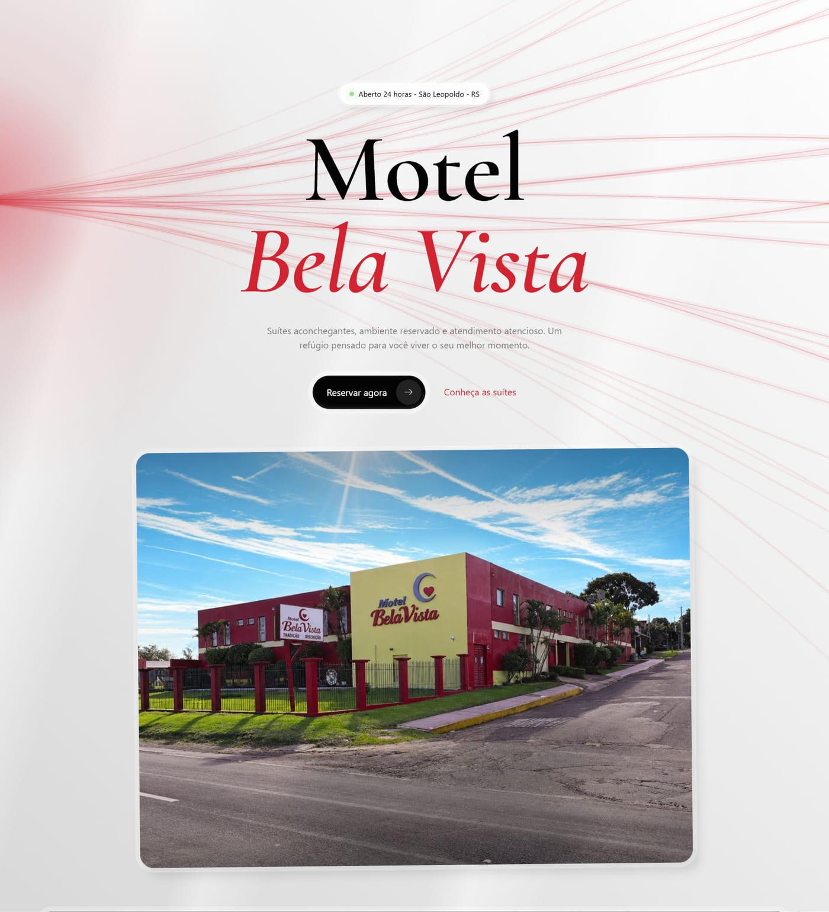 |
|  | 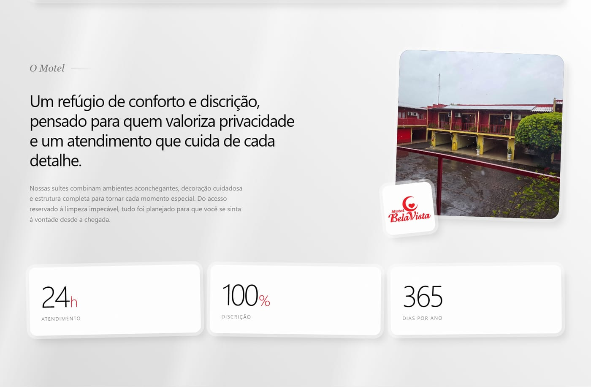 |

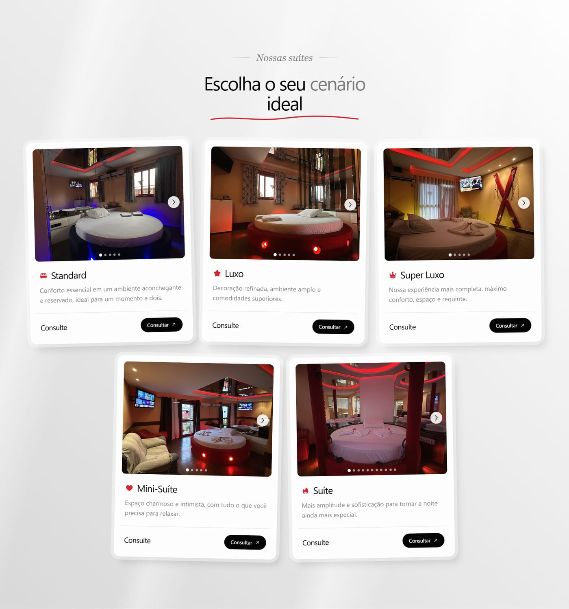

## No celular

| Início | Sobre | Suítes | Comodidades | Localização |
| :---: | :---: | :---: | :---: | :---: |
| 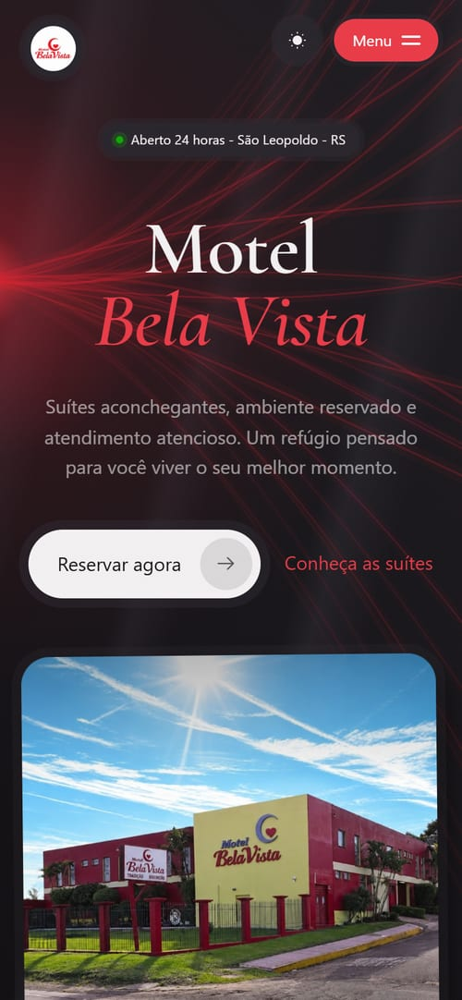 | 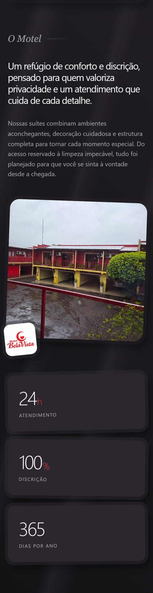 | 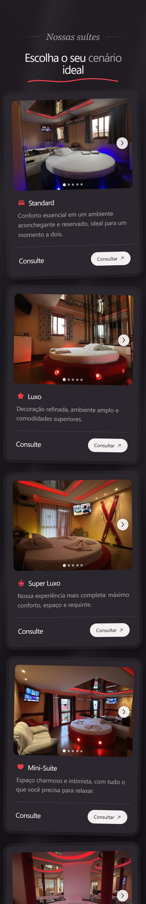 | 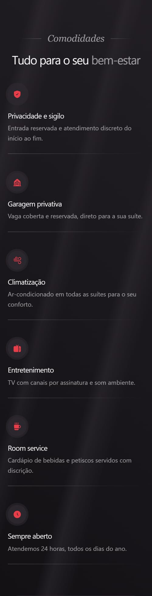 | 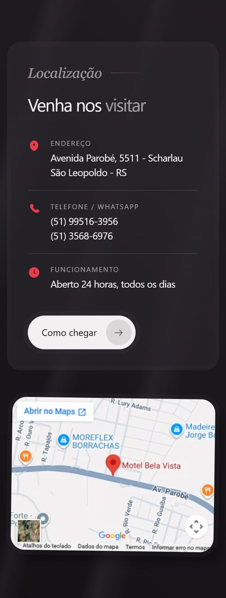 |

## Tecnologias

- [Vue 3](https://vuejs.org/) (`<script setup>`, estilos `scoped`) e [Vite](https://vite.dev/)
- [unplugin-icons](https://github.com/unplugin/unplugin-icons) com os conjuntos Solar e Simple Icons
- CSS próprio, sem framework: variáveis e estilos globais em `src/assets/styles/` e estilos de cada componente junto dele
- Fonte do título: Cormorant Garamond (Google Fonts)
- Publicação automática no GitHub Pages, com o domínio `motelbelavista.com`